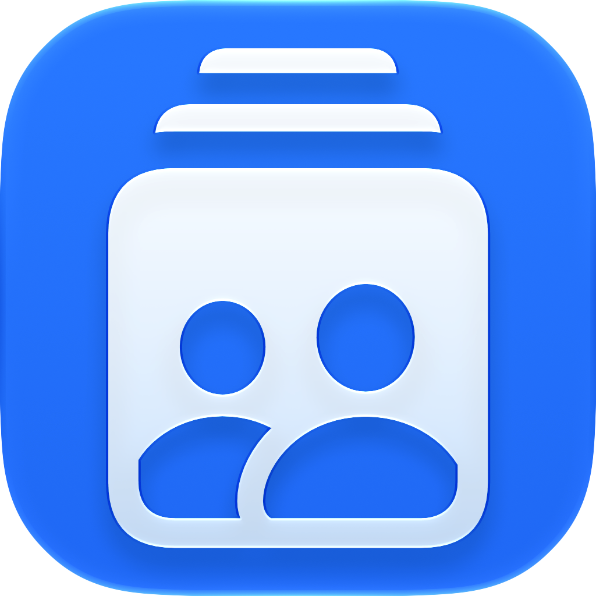

<p align="center">
  
</p>

<h1 align="center">LDAP Studio</h1>

<p align="center">
  A native macOS LDAP client for browsing, searching, and editing LDAP directories.
</p>

<p align="center">
  <a href="https://github.com/dethdkn/ldap-studio/releases/latest"></a>
  <a href="https://github.com/dethdkn/ldap-studio/releases"></a>
  
  <a href="LICENSE"></a>
</p>

<p align="center">
  <a href="https://github.com/dethdkn/ldap-studio/releases/latest"><b>Download</b></a> ·
  <a href="https://ldap-studio.app">Website</a> ·
  <a href="https://ldap-studio.app/changelog">Changelog</a> ·
  <a href="https://github.com/dethdkn/ldap-studio/issues">Report an Issue</a> ·
  <a href="https://github.com/sponsors/dethdkn">Sponsor</a>
</p>

---

## Features

- **Connections**: save, edit, and organize multiple LDAP connections; import and export them as JSON (with an optional, obscured password) or from LDAP Admin's `.lcf` format
- **Fast directory tree**: loaded on demand, so it stays fast on directories of any size (Active Directory included). Each branch is read when you expand it, with paged searches that never hit the server's size limit
- **Search**: quick search across the whole directory, plus advanced search with real LDAP filters (RFC 4515), progress, and cancel
- **Attribute editor**: add, edit, view, and delete attributes, including binary values
- **Photos**: view and set `jpegPhoto`, auto-resized and center-cropped to 300×300
- **Passwords**: set `userPassword` with client-side hashing (PBKDF2-SHA512 by default, plus Unix/MD5/SHA-256/SHA-512 Crypt, MD5, SHA1, SMD5, and SSHA for compatibility); the plaintext is never stored or sent as-is
- **Entry operations**: move, copy, create, and delete entries anywhere in the tree, whole branches included, counted first, with progress and cancel
- **LDIF**: import and export LDIF files
- **Schema browser**: object classes and attributes, with full superior-class inheritance resolved
- **Autocomplete**: attribute names and object classes, driven by the server's own schema, when adding attributes or creating entries
- **Native macOS**: menu bar integration for every major action

## Requirements

- macOS 27 (Golden Gate) or later
- Apple Silicon (arm64); there's currently no Intel build

## Installation

1. Download the latest release from the [Releases page](https://github.com/dethdkn/ldap-studio/releases/latest), e.g. `ldap-studio-vx.x.x.zip`.
2. Extract the zip and move `ldap-studio.app` to your `/Applications` folder.
3. The app isn't signed with a paid Apple Developer account, so the first time you open it macOS will say it's from an unidentified developer (or "not trusted").
   - Go to **System Settings → Privacy & Security**, scroll to the bottom, and click **Open Anyway**.
   - If it still won't open, run this in Terminal:

     ```bash
     xattr -cr /Applications/ldap-studio.app
     ```

### Updating

Download the newest version from the [Releases page](https://github.com/dethdkn/ldap-studio/releases/latest) and replace `ldap-studio.app` in your `/Applications` folder with it.

## Build from Source

The UI is SwiftUI and the LDAP core (`core/`) is C, built on Homebrew's OpenLDAP, OpenSSL, libxcrypt, and libssh2. You'll need Xcode and [Homebrew](https://brew.sh).

```bash
git clone https://github.com/dethdkn/ldap-studio.git
cd ldap-studio
brew bundle
```

Then open `ldap-studio.xcodeproj` in Xcode and run the `ldap-studio` scheme, or build a Release `.app` from the command line:

```bash
scripts/build.sh
```

The C core is compiled automatically as part of the Xcode build. `scripts/build.sh` packages the app as `dist/ldap-studio-test.zip`.

## Why I Made This

I use LDAP at [CBPF](https://cbpf.br), the research center I work at. The only real LDAP client available was LDAP Admin for Windows, which hasn't been updated in a long time and is Windows-only, meaning I needed a Windows virtual machine running just to open it. So I built my own, native to macOS.

> [!NOTE]
> I also wanted to learn Swift and C. I'm still learning both, so this app was built with the help of AI.

## Support

LDAP Studio is free and open source. If it's useful to you, consider [sponsoring the project](https://github.com/sponsors/dethdkn). Found a bug or have an idea? [Open an issue](https://github.com/dethdkn/ldap-studio/issues).

## License

[MIT](LICENSE) © Gabriel 'DethDKN' Rosa
